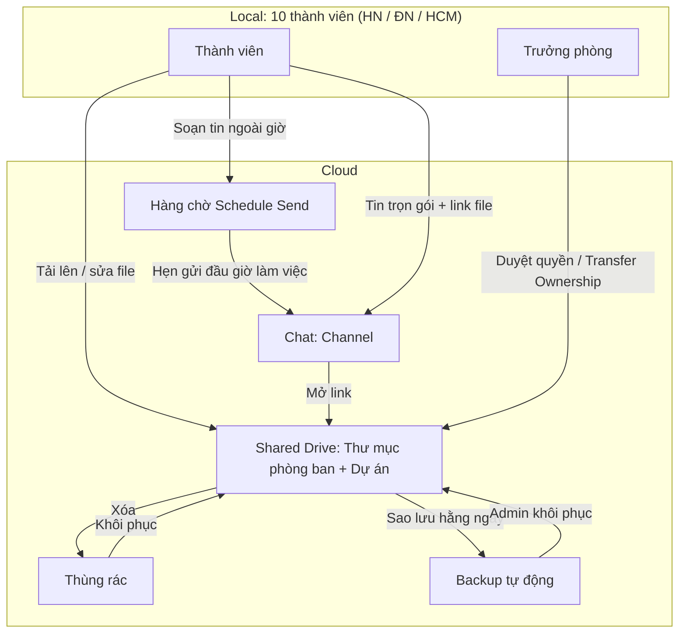

# Yêu cầu đầu ra

## Phần 1/ Thiết kế Kiến trúc

### 1.1/ Sơ đồ luồng dữ liệu cộng tác



### 1.2/ Danh sách Folder cần thiết

```
SmartHome-Startup/ (Shared Drive, chủ sở hữu = công ty)
├── 00_Cong-ty/              ← Chính sách, quy ước văn hóa; chỉ CEO sửa
├── 01_Ky-thuat/             ← Trưởng phòng Kỹ thuật quản lý
├── 02_Kinh-doanh-Marketing/ ← Trưởng phòng KD-MKT quản lý
├── 03_Van-hanh-Tai-chinh/   ← Nhạy cảm; người phòng khác không truy cập
├── 04_Du-an/                ← Mỗi dự án một thư mục con, nhóm liên phòng
├── 99_Luu-tru/              ← Dự án đã xong; chỉ đọc
└── _Backup/                 ← Bản sao tự động; chỉ Admin
```

### 1.3/ Danh sách Channel cần thiết

| Channel | Mục đích | Phản hồi |
|---|---|---|
| #thong-bao-chung | Thông báo toàn công ty; chỉ CEO đăng | Không cần |
| #ky-thuat | Trao đổi phòng Kỹ thuật | 24 giờ làm việc (đề xuất) |
| #kinh-doanh-marketing | Trao đổi phòng KD-MKT | 24 giờ làm việc (đề xuất) |
| #van-hanh-tai-chinh | Trao đổi phòng VH-TC | 24 giờ làm việc (đề xuất) |
| #du-an-[ten] | Mỗi dự án một channel | 24 giờ làm việc (đề xuất) |
| #hoi-dap | Câu hỏi không gấp, dùng chung | 24 giờ làm việc (đề xuất) |
| #su-co | Việc khẩn, được ping ngoài giờ | 30 phút (đề xuất) |
| #off-topic | Trò chuyện ngoài công việc | Không bắt buộc |

---

## Phần 2/ Bản quy ước văn hóa: 3 quy tắc quan trọng

1. **Tránh No-Hello Trap:** Không nhắn mỗi chữ "Chào". Tin đầu phải trọn gói: người nhận + việc cần + hạn + link.
   *Ví dụ: "@Hà nhờ duyệt file thiết kế X trước 17:00 thứ Năm. Link: …"*
2. **Không spam @all:** Chỉ CEO dùng @all/@channel, và chỉ ở #thong-bao-chung hoặc #su-co. Các trường hợp khác ping đúng người hoặc đúng channel phòng.
3. **Giờ yên lặng 21:00-07:30 (đề xuất):** Tin ngoài giờ bắt buộc dùng **Schedule Send**, hẹn gửi vào đầu giờ làm việc của người nhận. Không ai bị coi là chậm phản hồi khi đang ngoài giờ. Ngoại lệ duy nhất là #su-co.

> Xử lý Edge case: 
**Quy trình xử lý:**
 
| Hành động | Kết quả kiểm tra |
|---|---|
| 1. Người xóa báo ngay ở #su-co, không tự thao tác thêm | Có mốc thời gian sự cố |
| 2. Trưởng phòng khôi phục từ Thùng rác | Thư mục xuất hiện lại đúng vị trí |
| 3. Nếu Thùng rác không có, Admin khôi phục từ `_Backup/` | Lấy được bản sao gần nhất |
| 4. So số file và dung lượng với trước khi xóa | Hai số liệu khớp |
| 5. Ghi nguyên nhân và cách phòng tránh vào #su-co | Có biên bản sự cố |
